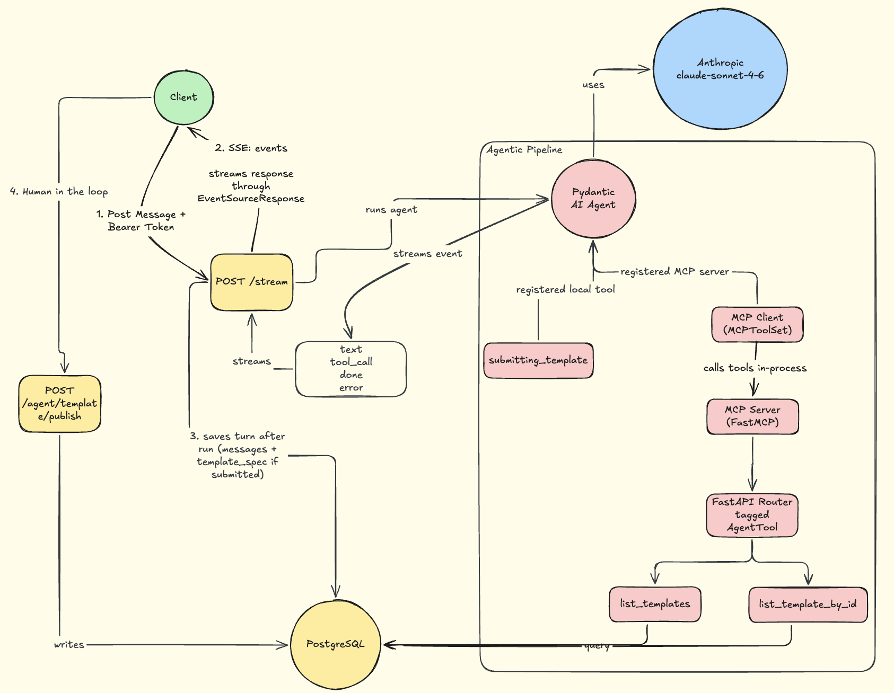

# Building an AI-Powered Template Generator: From a Week of Engineering to a Few Minutes

## Overview

I received a [Certificate of Achievement](https://www.linkedin.com/feed/update/urn:li:activity:7484871698677420032/) for finding a gap in our template creation process and building an AI-powered feature to fix it.

Before this feature, creating a new template  could take about a week. The process usually started when a client shared their requirements with our team. An engineer would then turn those requirements into a JSON template, often using AI tools to help write the initial version.

But generating JSON was only part of the work. The template had to follow our internal Domain-Specific Language (DSL), to ensure backward compatibility with front-end logic (work with our existing frontend), and support the conditional logic needed to display dynamic forms.

For example, a form might ask patients which diseases they have. When a patient selects Fever, another question asking for their body temperature should appear. A question could also reveal another question, and this could continue for as many steps as the client needed.

There was another challenge. The same form could appear in two places: the practitioner portal and the patient portal. But patients shouldn't always see the same wording as practitioners. We handled this using the `audience` and `secondary_text` attributes in our DSL.

For patient-facing questions, the frontend displays `secondary_text` when available and falls back to `text` otherwise.

Here's a simple example of how a conditional question works:

```json
{
  "sections": [
    {
      "id": "symptoms",
      "title": "Presenting Symptoms",
      "audience": "both",
      "visible_if": null,
      "questions": [
        {
          "id": "disease_001",
          "text": "Presenting complaint(s) — select all that apply",
          "secondary_text": "Which of these do you have?",
          "type": "multi_select",
          "options": ["Fever", "Flu"],
          "required": true,
          "visible_if": null
        },
        {
          "id": "fever_temperature",
          "text": "Recorded body temperature (°C)",
          "secondary_text": "What is your temperature?",
          "type": "number",
          "placeholder": "e.g. 38.5",
          "visible_if": {
            "field": "symptoms.disease_001",
            "op": "in",
            "value": ["Fever"]
          }
        }
      ]
    }
  ]
}
```

On top of the initial implementation, engineers often had to go back and forth with clients to make changes. Even a small change could mean another round of development.

I thought we could make this process much simpler.

I proposed adding an AI-powered template generator that super admins could use directly. Instead of asking an engineer to write or update the JSON, an admin could describe what the client needed, and the AI would generate the template.

There were two things the AI had to get right:

1. Decipher client's requirements
2. Generate JSON that followed all the rules of our DSL so front-end renders it fine

## Impact

The change made a big difference to how we handle template creation.

- Template turnaround went from about a week to just a few minutes. Since launch, the AI has been used in 74 conversations, and 48 of them have produced a complete template.
- So far, 45 templates have been reviewed and published: 21 clinical templates and 24 PGD templates.
- A full generation takes around five minutes and costs approximately $0.98 in model usage. Most templates need around two drafts, bringing the estimated cost of a finished template to roughly $2.
- The biggest change is that admins can now handle client requests themselves. They no longer need an engineer to write or modify the template JSON.

---

## How It Works

I designed the workflow so the AI could use our existing backend functionality, understand our current templates, generate new ones, and check its output against our DSL before handing it over to an admin.

Here's the architecture I designed:



[Open the interactive diagram on Excalidraw](https://link.excalidraw.com/readonly/8MuKRqjkNEt8FxipLuU8)

### i. Real-Time Updates with Server-Sent Events (SSE)

Generating a complete template takes around five minutes. With a normal request-response approach, the admin would have to wait for the entire process to finish without knowing what was happening.

I wanted admins to see the AI's progress instead of just staring at a loading spinner. That's why I used Server-Sent Events (SSE).

Whenever an admin sends a message, the browser makes a `POST /stream` request. The server keeps the response open and sends events back using `EventSourceResponse`.

The frontend receives these events and displays what the AI is doing. For example, admins can see which tool the AI is calling and read its response as it is written.

A typical interaction looks like this:

```text
thinking  → ""
tool_call → "Fetching Templates"
tool_call → "Fetching Template"
tool_call → "Submitting Template"
text      → "Template spec ready" (sent in chunks)
done      → {"template_spec": {...}}
```

Once the agent finishes its turn, we save the conversation history in the database and send the final `done` event containing the generated template.

This way, admins can follow the entire process instead of waiting several minutes without any updates.

### ii. Exposing Existing APIs Through MCP

The next part was making our existing backend functionality available to the AI.

I used the Model Context Protocol (MCP) for this. It provides a standard way for AI clients to connect with tools exposed by different services.

Without MCP, every AI client would need its own custom integration with every service it uses. As the number of clients and services grows, this creates an N × M integration problem.

MCP reduces this to N + M. Each service exposes its tools through an MCP server, and compatible AI clients can connect to those tools without needing to know how each service works internally.

And I am not saying that MCP replaces our existing APIs but it works alongside them.

In our implementation, the tools are backed by our existing FastAPI routes. We mark the routes we want to expose using `AgentTool`, and FastMCP makes them available as MCP tools.

This allowed us to reuse our existing backend functionality instead of building separate implementations just for the AI.

### iii. Agent Orchestration with Pydantic AI

After exposing the tools, we needed a way to manage how the AI uses them.

We chose Pydantic AI because it works well with our Python backend and handles most of the agent orchestration for us.

We define the expected output schema, register the tools, and set a retry limit. Pydantic AI manages the agent loop through `agent.iter`. It sends requests to the model, executes tools when needed, and passes their results back into the conversation until the task is complete.

It also validates the model's output against our Pydantic schema. When validation fails, the errors are sent back to the model so it can correct the output. This continues until the output is valid or the configured retry limit is reached.

Pydantic AI also handles communication with the model provider, making it easier to switch models or introduce fallbacks without rewriting our agent.

For debugging, we use Logfire to track model requests, tool calls, and execution traces. This makes it easier to understand what happens during a generation and investigate issues.

### iv. Tools and the Generation Workflow

The agent has access to two tools through our MCP server:

1. `list_templates`
2. `list_template_by_id`

The first tool lists the available templates, helping the AI find existing examples that might be useful for the client's requirements.

The second tool fetches the complete JSON of a selected template. This gives the AI the structure and details it needs when creating a new template or updating an existing one.

We also have a third tool called `submitting_template`, which I defined directly on the agent rather than exposing it through MCP.

This is where our custom DSL validation takes place. Whenever the AI generates a template, it submits the JSON through this tool. The tool checks it against our validation rules and returns any errors to the AI. The AI then fixes the issues and submits the template again.

This process continues until we get a valid `template_spec` or reach the configured `max_retries`.

### v. DSL Validation and Frontend Compatibility

Our DSL defines how templates should be structured, which attributes are allowed, what question types we support, and how conditional checks should be written.

We defined these rules using Pydantic models and made sure they match the TypeScript types our frontend uses to render forms. This means we validate more than just the JSON structure: we also make sure the generated template follows the same rules the frontend expects.

For example, we support 10 question types: `text`, `textarea`, `single_select`, `multi_select`, `boolean`, `date`, `number`, `show`, `country_select`, and `gender_select`. We also enforce rules such as allowing `ui: radio` only for `single_select` questions and making sure conditional visibility rules follow the expected structure.

I also wanted this validation layer to be easy to extend. Adding a new question type is relatively rare, but when it happens, we can extend the existing schema with the new type and its validation rules without having to rewrite the core validation workflow.

This follows the **Open-Closed Principle (OCP)**: the existing validation logic remains unchanged while the supported template structure can be extended as requirements evolve.

Keeping our backend models aligned with the frontend types also helps us maintain backward compatibility and ensures that templates passing validation have the structure our frontend knows how to render.

### vi. Keeping Backend Validation in Sync with the Frontend

Another important part of this implementation was making sure our backend validation matched what the frontend actually supports.

Our backend validation models mirror the TypeScript types used by the frontend to render forms.

This means we don't just check whether the generated JSON is valid. We also check whether it follows the same structure and rules that the frontend expects.

Keeping these definitions aligned helps us maintain backward compatibility and ensures that templates passing backend validation have the structure needed by our frontend.

### vii. Conversation State and Draft Continuity

Template creation isn't always a one-time conversation. An admin might start generating a template, review the result, discuss changes with a client, and return to it later.

To support this, every conversation is saved as a session in the database. Admins can leave a conversation and continue from where they stopped without losing its context.

At the same time, we keep the agent's last valid version as a reference. This helps the AI identify and fix manual changes that may have broken the DSL rules.

### Keeping a Human in the Loop

Even though the AI handles generation and validation, it never publishes a template on its own.

The AI only produces a draft. A super admin reviews the generated template, makes any necessary changes, and publishes it once everything is approved.

Publishing is a separate operation, and the AI doesn't have access to it. This means generated changes can never directly affect live templates.

This is especially important for clinical forms. A template can be valid JSON and still contain questions or logic that aren't appropriate for the client's requirements. Having an admin review every draft gives us an additional level of control before anything goes live.

---

## Optimisations

Once the main workflow was working, I also looked at ways to reduce generation costs and avoid unnecessary work.

A generation can involve several model requests and tool calls, so even small improvements can make a difference when the feature is used regularly.

### a. Reducing Token Usage and Generation Cost

One of the things I optimized was the system prompt.

The system prompt for template generation lives in `templates.py`. It contains the instructions, DSL rules, structural requirements, and examples the AI needs to generate valid templates.

It is approximately 49,267 characters long, with 7,090 words and an estimated token count of 12K–16K.

Since this prompt is sent repeatedly across model requests, I enabled Anthropic's prompt caching specifically for the system prompt. This allows eligible subsequent requests to reuse the cached prompt at a lower input-token cost instead of processing it at the standard input rate every time.

I also implemented caching for MCP tool results. Whenever the AI fetches existing templates, we save the results and reuse them in subsequent turns instead of making the same tool calls again.

Another thing we did was avoid sending unnecessary template versions back to the model. Every generated version is saved in the database, but we only include the latest version in subsequent requests. Older versions would increase token usage without adding much value.

When an admin is updating an existing template, we also include its current JSON directly in the message context. This saves the AI from making another tool call to fetch something we already have.

### Failing Fast Before Expensive Model Calls & Prevent Infinite Running Agents

Long conversations can become so large that they exceed the model's input limits.

Instead of finding this out after making an API request, I added a step to estimate the conversation's size before calling the model.

The estimate intentionally overestimates the actual token count. This helps us stop oversized requests early rather than paying for a request that would fail because the prompt is too long.

Each generation run also has a 30-minute timeout. Since a normal generation takes around five minutes, this gives the agent enough time for tool calls and validation retries while still preventing a run from getting stuck indefinitely.

### Managing Database Connections

Another thing I considered was how database connections are used during generation.

Since generating a template can take several minutes, keeping a database connection open throughout the entire process would unnecessarily occupy a connection from the pool.

To avoid this, we release the database connection before starting AI generation and open a new one only when we need to perform database operations, such as saving the completed conversation.

This keeps database connections available for other application requests instead of holding them while the AI is working.

---

## Final Thoughts

The main achievement wasn't just adding AI to our application. It was finding a process that required unnecessary engineering effort and making it something our admins could handle themselves.

By combining Pydantic AI, MCP, DSL validation, real-time updates, and human review, we reduced template creation from about a week to a few minutes.

More importantly, we made this possible without changing the existing frontend contract or giving the AI direct access to publish live templates.
